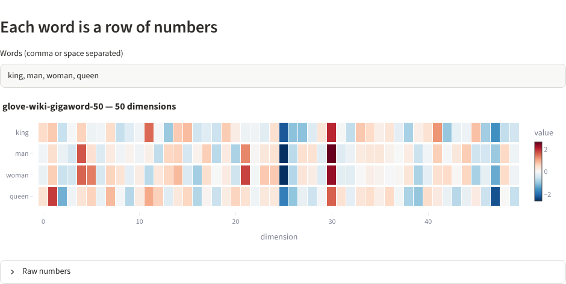
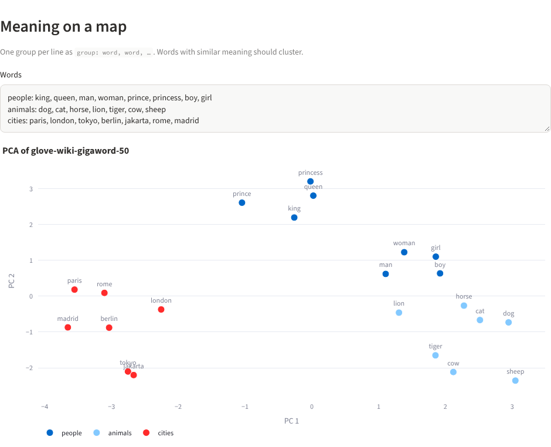

# VecScope

**vector + scope**: a small Streamlit app for looking inside language models. Type a sentence and see how it gets cut into tokens, how each word becomes a list of numbers, and how those numbers capture meaning. Upload an image and see it land in the same vector space as text.

## Why

"Tokens" and "embeddings" are usually explained with a diagram and a promise. VecScope lets you poke at the real thing:

- Two tokenizers rarely agree. GPT-2 splits the test sentence below into 19 tokens, BERT into 23.
- A word vector is just 50 numbers, but `man` and `woman` have visibly similar color patterns, and `king - man + woman` really does land next to `queen`.
- CLIP puts a photo of a cat and the text "a photo of a cat" close together, which is what makes text-to-image search work.

It is a learning and portfolio project, not a chatbot. Full plan: [PLAN.md](PLAN.md).

## What it does

| Tab | Shows |
| --- | --- |
| Tokens | One sentence, two tokenizers side by side: GPT-2 BPE (`tiktoken`), BERT WordPiece, GPT-4 `cl100k_base`, GPT-4o `o200k_base`. Tokens, IDs, counts. |
| Vector strips | GloVe word vectors as colored rows. Red = positive, blue = negative. |
| Similarity | Cosine similarity matrix, pair table, nearest neighbours. |
| 2D map | PCA (default) or UMAP projection of grouped words. |
| Analogy | `a - b + c` with top-k results and the vectors involved. |
| Images (CLIP) | Text-to-image search, text ↔ image similarity, 512-d image strips, mixed text + image map. |

Words not in the GloVe vocabulary are skipped with a warning. GloVe is lowercase English, so input is lowercased.

## Run it

Python 3.10+.

```bash
python -m venv .venv
```

```bash
source .venv/bin/activate
```

```bash
pip install -r requirements.txt
```

```bash
python scripts/download_samples.py
```

```bash
streamlit run app.py
```

Models download on first use and are cached outside the repo:

| Model | Size | Cache |
| --- | --- | --- |
| `glove-wiki-gigaword-50` | ~66 MB | `~/gensim-data` |
| `bert-base-uncased` tokenizer | <1 MB | `~/.cache/huggingface` |
| `tiktoken` encodings | 1–4 MB each | tiktoken cache |
| `openai/clip-vit-base-patch32` | ~600 MB | `~/.cache/huggingface` |

CLIP only loads after you switch it on in the Images tab. UMAP is optional: `pip install umap-learn`.

Tests (downloads GloVe and the BERT vocab on first run):

```bash
python -m pytest -q
```

## Evidence

Numbers below come from `python scripts/evidence.py`. Screenshots come from `node scripts/screenshots.js` against a running app.

### Tokens: GPT-2 vs BERT

Sentence: `Tokenization isn't magic: unbelievably, GPT-2 and BERT split words differently!`

**GPT-2 BPE: 19 tokens**

```text
Token (30642) | ization (1634) | ␣isn (2125) | 't (470) | ␣magic (5536) | : (25) | ␣unbelievably (48943) | , (11) | ␣G (402) | PT (11571) | - (12) | 2 (17) | ␣and (290) | ␣B (347) | ERT (17395) | ␣split (6626) | ␣words (2456) | ␣differently (10338) | ! (0)
```

**BERT WordPiece: 23 tokens**

```text
token (19204) | ##ization (3989) | isn (3475) | ' (1005) | t (1056) | magic (3894) | : (1024) | un (4895) | ##bel (8671) | ##ie (2666) | ##va (3567) | ##bly (6321) | , (1010) | gp (14246) | ##t (2102) | - (1011) | 2 (1016) | and (1998) | bert (14324) | split (3975) | words (2616) | differently (11543) | ! (999)
```

GPT-2 keeps `unbelievably` as one token and splits `GPT` into `G` + `PT`. BERT lowercases everything and breaks `unbelievably` into five pieces. `␣` marks a leading space; `##` marks a word continuation.


### Vector strips

All four words are strongly blue at dimension 25 and red at 30. Beyond that, `man` and `woman` share red at dimensions 4 and 21, which `king` lacks; `king` and `queen` share a deep blue at 47. Euclidean distance agrees: `man`–`woman` is 2.60, `king`–`man` is 5.14.



### Cosine similarity (GloVe 50d)

| word A | word B | cosine |
|---|---|---|
| king | queen | 0.784 |
| man | woman | 0.886 |
| king | man | 0.531 |
| king | woman | 0.411 |
| king | water | 0.235 |
| queen | apple | 0.204 |


### 2D map (PCA)

People, animals and cities form three separate groups. Royalty (`king`, `queen`, `prince`, `princess`) sits apart from `man`, `woman`, `boy`, `girl`.



### Analogy: king - man + woman

| rank | word | cosine |
|---|---|---|
| 1 | queen | 0.852 |
| 2 | throne | 0.766 |
| 3 | prince | 0.759 |
| 4 | daughter | 0.747 |
| 5 | elizabeth | 0.746 |

Gensim's `most_similar` excludes the input words, so `king` itself can't be the answer.


### CLIP: text ↔ image

Seven sample images, five text queries. Raw CLIP cosines between text and images are small (around 0.1–0.3); the ranking is what matters. The last query has no matching image and its best score is the lowest of the five.

| query | #1 | #2 | last |
|---|---|---|---|
| a photo of a cat | cats.jpg (0.267) | cat-chonk.jpg (0.253) | mosque.jpg (0.150) |
| a bee on a flower | bee.jpg (0.298) | robot.png (0.169) | dog.png (0.114) |
| a robot | robot.png (0.273) | cat-chonk.jpg (0.185) | baklava.jpg (0.141) |
| a sweet pastry | baklava.jpg (0.243) | cat-chonk.jpg (0.216) | mosque.jpg (0.157) |
| a car on a highway | robot.png (0.177) | cat-chonk.jpg (0.174) | baklava.jpg (0.121) |


In the mixed map, all text sits on one side and all images on the other. This is CLIP's known *modality gap*: the two encoders use different regions of the shared space. Ticking "Close the modality gap" centers each group separately, and matching pairs line up (`a photo of a cat` next to the cat photos, `a bee on a flower` next to `bee.jpg`):


## Project layout

```text
app.py                 Streamlit UI
src/tokenize.py        tiktoken vs BERT WordPiece
src/embeddings.py      GloVe loading and lookup
src/similarity.py      cosine, nearest neighbours, analogy
src/visualize.py       Plotly strips, heatmaps, PCA/UMAP scatter
src/clip.py            CLIP text and image embeddings
scripts/               sample download, evidence, screenshots
tests/                 fixed examples from the plan
```

## Notes

- Sample images come from [`huggingface/documentation-images`](https://huggingface.co/datasets/huggingface/documentation-images) (CC BY-NC-SA 4.0). They are downloaded by the script, not committed.
- Uploaded images stay in memory and are never written to disk.
- Behind a restrictive proxy, Hugging Face's Xet downloads may fail. `HF_HUB_DISABLE_XET=1` falls back to plain HTTPS.

## Roadmap

Done: everything in v1, plus CLIP, modern tiktoken encodings and the UMAP option from v2. Next: Sentence Transformers sentence embeddings, then Indonesian support (IndoBERT or a multilingual model, `raja - pria + wanita`) and a Hugging Face Spaces demo. See [PLAN.md](PLAN.md#6-milestone).

## Credits

Visual style from Jay Alammar's [The Illustrated Word2vec](https://jalammar.github.io/illustrated-word2vec/). Built on [tiktoken](https://github.com/openai/tiktoken), [Transformers](https://huggingface.co/docs/transformers), [Gensim](https://radimrehurek.com/gensim/), [GloVe](https://nlp.stanford.edu/projects/glove/) and [CLIP](https://huggingface.co/openai/clip-vit-base-patch32).
